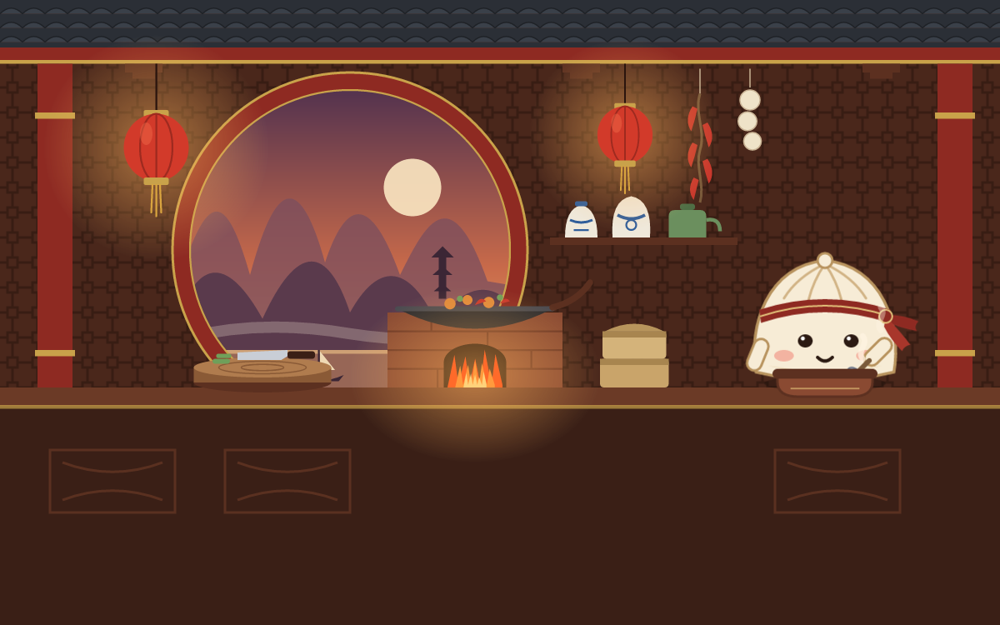

# WokFlow 锅

[](https://github.com/abhihakhu/wokflow/actions/workflows/ci.yml)

WokFlow turns a study or work session into cooking a dish in a traditional harbor kitchen, with a companion character who cooks alongside you. It is built for two problems: **getting started**, and **staying focused long enough to actually understand** what you're working on.



<!-- TODO: replace with a GIF of the Prep → Simmer → Plate loop recorded from `pnpm tauri dev` (default pack). -->

## The loop

| Phase                    | What you do                                                                                                                                                     | Why                                                         |
| ------------------------ | --------------------------------------------------------------------------------------------------------------------------------------------------------------- | ----------------------------------------------------------- |
| **Prep** (mise en place) | Pick a task, write the smallest first step, and say what you want to understand by the end.                                                                     | A concrete first step beats a vague task.                   |
| **Simmer**               | Focus while the companion cooks beside you. Drop stray thoughts into the **parking lot** instead of acting on them. If you hide the app, the companion notices. | Body doubling, plus a place to put distractions.            |
| **Plate**                | Explain what you learned in 2–3 sentences and rate your focus.                                                                                                  | Rewards understanding, not minutes logged.                  |
| **Serve**                | Earn coins and ingredients that unlock decor and new areas of the harbor.                                                                                       | No streaks to lose. A missed day is just a quieter kitchen. |

```
coins = focused minutes + 10 (reflection with ≥ 2 real sentences) + focus rating × 2 − min(away episodes, 5)
```

## Architecture

```
wokflow/
├─ apps/
│  └─ desktop/          # React + Vite UI (views/, state/), Tauri 2 shell (src-tauri/)
├─ packages/
│  ├─ core/             # pure domain logic: sessions, rewards, recipes (no I/O)
│  ├─ data/             # Store / Platform interfaces, in-memory + SQLite adapters, migrations
│  ├─ companion/        # character pack schema, validation, state → animation mapping
│  └─ scene/            # PixiJS kitchen: layered art, fire, steam, lanterns, companion player
├─ packs/
│  └─ default/          # "Ember", the original default companion (generated by scripts/)
├─ scripts/             # build-default-pack.mjs: draws Ember's sprite sheets
└─ docs/adr/            # architecture decision records
```

- **Core is pure.** Every session transition takes `now` explicitly, so the whole focus timer, including pauses and leave detection, is deterministic and unit-tested.
- **Platforms are injected.** The UI depends on a `Platform` interface (`store`, `notify`, `onAppHidden`, `onAppVisible`). Desktop and Android each provide one, so core and UI never import Tauri or Capacitor.
- **Storage is swappable.** A two-method `SqlDriver` sits under a document-style SQLite store; the same contract tests run against the in-memory and SQLite adapters.
- **The scene is mostly pure functions.** Layout, particles, flames and sprite-sheet slicing are unit-tested; the PixiJS layer just draws them. It honors `prefers-reduced-motion` and loads lazily after the menu.
- **Companions are packs.** Drop a folder in `packs/` with a `pack.json` and sprite sheets. Only the default pack is committed; see [packs/README.md](packs/README.md).

Decisions: [stack](docs/adr/0001-monorepo-and-stack.md) · [character packs](docs/adr/0002-character-packs.md) · [leave detection](docs/adr/0003-leave-detection.md) · [visual direction](docs/adr/0004-visual-direction.md) · [SQLite storage](docs/adr/0005-sqlite-storage.md) · [kitchen scene](docs/adr/0006-kitchen-scene.md)

## Getting started

Requires Node 22+ and pnpm 10 (`corepack enable`).

```bash
pnpm install
pnpm dev          # browser build at http://localhost:5173 (demo data, resets on reload)
pnpm test         # unit tests
pnpm coverage     # with coverage thresholds (80%)
pnpm lint && pnpm typecheck
```

### Desktop app (Tauri)

Install Rust (`rustup`) and the [Tauri prerequisites](https://v2.tauri.app/start/prerequisites/) for your OS, then:

```bash
cd apps/desktop
pnpm tauri dev    # native window with hot reload; data persists in SQLite
pnpm tauri build  # installer in src-tauri/target/release/bundle
```

## Roadmap

- [x] **M1** Monorepo, CI, core domain + tests, data interfaces, pack schema, working Prep → Simmer → Plate loop
- [x] **M2** SQLite storage (Tauri), task editing, recipes and signature dishes, persistent wallet
- [x] **M3** PixiJS kitchen scene + default companion art (README GIF still to record)
- [ ] **M4** In-app pack picker (packs already load from `packs/` at build time; see [packs/README.md](packs/README.md))
- [ ] **M5** Rewards UI, decor → **v0.1 release**
- [ ] **M6** Android (Capacitor) + local notifications → v0.2
- [ ] Later: sync, Harbor Map, iCal deadline import, LLM-generated recipes and quizzes

## License

MIT for the code and the default pack. Personal packs you add are not covered and stay under their own terms.
