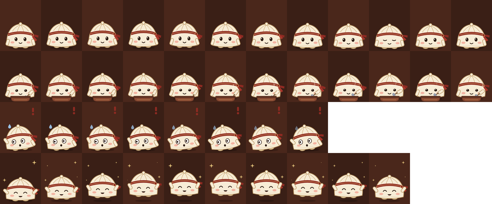

# Character packs

A pack is a folder with a `pack.json` plus the art it points to. WokFlow loads one pack as the companion that keeps you company in the kitchen.

```
packs/
├─ default/        # "Ember", the original default character (committed)
└─ <your-pack>/    # anything else stays on your machine (gitignored)
```

## Why personal packs are gitignored

Only `packs/default/` is part of this repository. Any other folder you drop here is ignored by git, so you can use art that is licensed for **personal, non-commercial use only** (for example, a fan-sourced model whose terms forbid redistribution) without ever publishing it.

## pack.json

Validated by `@wokflow/companion` (`parsePack`). Every pack must animate four states:

| Companion state | When                         | Line set   |
| --------------- | ---------------------------- | ---------- |
| `idle`          | Prep, paused, no session     | `prep`     |
| `focus`         | Simmering                    | `focus`    |
| `away`          | You left the app mid-session | `away`     |
| `complete`      | Plate / served               | `complete` |

```json
{
  "id": "my-pack",
  "name": "My Cook",
  "renderer": "sprites",
  "states": { "idle": "idle", "focus": "cooking", "away": "notice", "complete": "cheer" },
  "sprites": {
    "idle": { "sheet": "idle.png", "frames": 12, "fps": 10 },
    "cooking": { "sheet": "cooking.png", "frames": 16, "fps": 12 },
    "notice": { "sheet": "notice.png", "frames": 8, "fps": 10 },
    "cheer": { "sheet": "cheer.png", "frames": 12, "fps": 12, "loop": false }
  },
  "lines": {
    "prep": ["What are we cooking up today?"],
    "away": ["Hey, the pot’s still on…"]
  }
}
```

- **Sprite sheets** are horizontal strips: `frames` equal-width frames side by side, transparent background. Set `frameWidth`/`frameHeight` if your strip has padding.
- **Rive** packs use `"renderer": "rive"` with `file` (a `.riv`) and `stateMachine`; `states` then names Rive states.
- **Lines** are optional per state; missing ones fall back to built-in lines.

## Making sprites from a 3D (MMD) model

1. Install Blender and the MMD Tools add-on; import the `.pmx`.
2. Pose or animate each state; set a fixed camera framing her from the knees up.
3. Render with toon/flat shading and **Film → Transparent** to a PNG sequence.
4. Pack each sequence into a horizontal strip (e.g. `ffmpeg -i frame_%03d.png -vf tile=16x1 cooking.png` for 16 frames, or TexturePacker).
5. Put the strips and a `pack.json` in `packs/<id>/`.

## Using your pack

Packs are bundled at build time, so a folder in `packs/` is all it takes. Restart `pnpm tauri dev`, open **Settings** (the gear in the header) and pick your companion; the picker shows each pack's first idle frame, and explains what's wrong with any pack that fails validation.

For quick testing you can also preselect one with an environment variable (the choice in Settings wins once you've saved one):

```bash
cd apps/desktop
VITE_COMPANION_PACK=xiangling pnpm tauri dev
```

A missing or invalid pack falls back to the default and logs why in the dev console. Frames are scaled so their height fits the companion spot on the counter (420 px of the 1600×1000 kitchen); leave a little transparent headroom in each frame for jumps and effects.

## The default pack

Ember's sprite sheets are drawn in code by `scripts/build-default-pack.mjs`. Change a pose there and run `pnpm pack:default` to regenerate the PNGs, `pack.json` and the preview in `docs/images/`.


